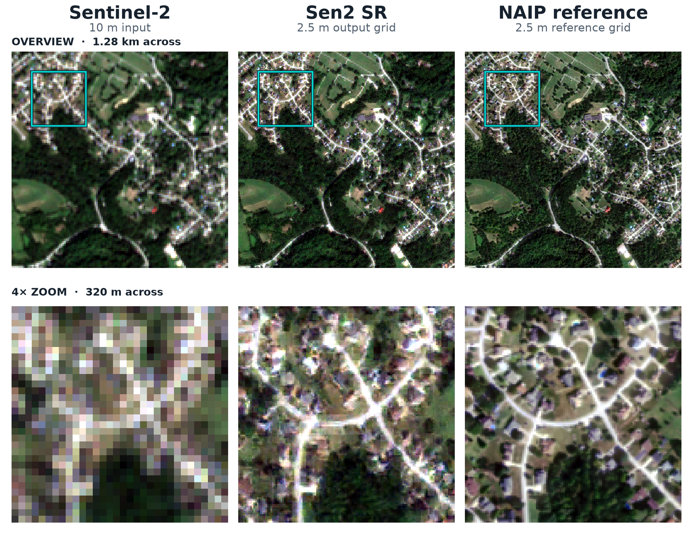

# OpenSR-SRGAN

| **PyPI** | **Versions** | **Docs & License** | **Tests** | **Reference** |
|:---------:|:-------------:|:------------------:|:----------:|:--------------:|
| [](https://pypi.org/project/opensr-srgan/) | <br> | [](https://srgan.opensr.eu)<br> | [](https://github.com/ESAOpenSR/SRGAN/actions/workflows/ci.yml)<br>[](https://codecov.io/github/ESAOpenSR/SRGAN) | [](https://arxiv.org/abs/2511.10461)<br>[](https://doi.org/10.5281/zenodo.17590993)<br><a style="border-width:0" href="https://doi.org/10.21105/joss.11254"></a> |

OpenSR-SRGAN is a comprehensive toolkit for training and evaluating super-resolution GANs on remote-sensing imagery. It packages a flexible generator/discriminator zoo, composable perceptual and reconstruction losses, and the training heuristics
that make adversarial optimisation tractable—generator warm-up phases, learning-rate scheduling, adversarial-weight ramping, and more. All options are driven by concise YAML configuration files so you can explore new architectures or datasets without
rewriting pipelines.  
  
Whether you are reproducing published results, exploring new remote-sensing modalities, or trying to establish benchmarks, OpenSR-SRGAN gives you a clear and extensible foundation for multispectral super-resolution research.

## Featured model: Sen2 SR v1

**Sentinel-2 10 m → 2.5 m, across RGB and NIR.** Try a published model built with this framework: a 23-block ESRGAN with PatchGAN, spectral and perceptual objectives, local-Gram texture learning, and EMA inference weights. Explore the recipe, use the pretrained checkpoint, or continue its real Sentinel-2/NAIP training run.

[Recipe & results](sen2-sr.md){ .md-button .md-button--primary }
[Download EMA checkpoint · 68 MB](https://huggingface.co/simon-donike/SR-GAN/resolve/b31d2728952cfaa022bd1df92d82a54c23cf4f8f/models/sen2-sr/v1/weights/inference.ckpt?download=true){ .md-button }
[Training YAML](https://huggingface.co/simon-donike/SR-GAN/blob/b31d2728952cfaa022bd1df92d82a54c23cf4f8f/models/sen2-sr/v1/training/config.yaml){ .md-button }

[](assets/sen2-sr-v1-rgb.png)

*A suburban validation scene: 1.28 km overview above, 4× zoom into the highlighted 320 m neighborhood below. Sentinel-2, released Sen2 SR with back-projection, and NAIP reference share the same display stretch. Click for full size; see the [results and evaluation scope](sen2-sr.md#results-and-evaluation-scope).*

```python
from opensr_srgan import load_inference_model

model = load_inference_model("SEN2-SR", map_location="cpu")
# BCHW tensor of raw Sentinel-2 DN, in B04/B03/B02/B08 order.
sr_dn = model.predict_step(raw_dn_tensor)
```

Install with `python -m pip install opensr-srgan==1.1.0`. The [model guide](sen2-sr.md) includes a complete tensor smoke test, both checkpoint downloads, and a full-state continuation example.

## Why this repository?

* **One configuration, many models.** Swap between SRResNet, RCAB, RRDB, large-kernel attention, ESRGAN, SwinIR, and stochastic generators, plus standard SRGAN, PatchGAN, and ESRGAN discriminators, by editing config values.
* **Loss combinations that just work.** Mix pixel, spectral-angle, perceptual, total-variation, local-Gram texture, and adversarial objectives with sensible defaults for weights, schedules, and warm-up durations.
* **Battle-tested training loop.** PyTorch Lightning handles device placement, multi-GPU DDP, and restartable checkpoints while the repo layers in GAN-specific manual optimisation, adversarial weight ramping, gradient clipping, and learning-rate scheduling.
* **Lightning 2+ training path.** Training uses manual optimization (`automatic_optimization=False`) and a single GAN training-step implementation.
* **Remote-sensing aware defaults.** Normalisation, configurable histogram matching/back-projection, spectral-band handling, and Sentinel-2-oriented presets are ready-made for RGB-NIR and SWIR-style workflows and are extensible to other sensors.

## What you get out of the box

| Capability | Highlights |
| --- | --- |
| **Generators & discriminators** | SRResNet, RCAB, RRDB, large-kernel attention, ESRGAN, SwinIR, stochastic generators, standard SRGAN, PatchGAN, and ESRGAN discriminators. |
| **Losses** | Weighted combinations of L1, spectral-angle, perceptual (VGG/LPIPS), local-Gram texture, total-variation, BCE/Wasserstein, and optional relativistic adversarial losses. |
| **Training utilities** | Generator warm-up phases, on-plateau learning-rate schedules, adversarial-weight ramping, gradient clipping, and EMA tracking. |
| **Experiment management** | Weights & Biases or CSV logging, checkpointing, saved resolved configs, and Hydra experiment presets. |
| **Datasets** | Bundled example dataset for quick smoke tests plus a selector designed for custom collections. |
| **Deployment** | PyPI package (`opensr-srgan`) with helpers to load Lightning modules from configs or download pre-trained presets from the Hugging Face Hub. |

## Install in two ways

* **From PyPI for inference** – `python -m pip install opensr-srgan` installs the lightweight package that exposes
  `load_from_config` and `load_inference_model`. The former instantiates a Lightning module from any repo config +
  checkpoint path, while the latter fetches the published SEN2-SR, RGB-NIR, and SWIR presets from the
  [`simon-donike/SR-GAN`](https://huggingface.co/simon-donike/SR-GAN) model repository on Hugging Face.
* **From source for training & development** – clone this repository when you want to modify architectures, retrain
  models, or work on new datasets. The [Getting started](getting-started.md) guide covers environment setup.

## Repository Tour

| Path | Description |
| --- | --- |
| `opensr_srgan/model/` | Lightning module, generator and discriminator implementations, and loss definitions. |
| `opensr_srgan/data/` | Dataset wrappers and helper utilities for custom and preconfigured SR datasets. |
| `opensr_srgan/configs/` | Ready-to-run YAML presets covering common scale factors, band selections, and architecture pairings. |
| `opensr_srgan/utils/` | Logging helpers, spectral normalisation utilities, and model summary functions used across the stack. |
| `opensr_srgan/train.py` / `opensr_srgan/train_hydra.py` | Legacy YAML and Hydra entry points that wire configuration, data module, loggers, and the Lightning trainer together. |

## Typical workflow

1. **Pick a configuration.** Start from `opensr_srgan/configs/config_training_example.yaml` for a smoke test, or use a Hydra preset such as `experiment=example`, `experiment=10m`, or `experiment=20m` and adapt dataset paths, scale, generator, discriminator, and loss options to match your experiment.
2. **Prepare datasets.** Download the bundled example dataset or register your own source with the dataset selector (see
   [Data](data.md)).
3. **Launch training.** Run `python -m opensr_srgan.train --config <path>`, `python -m opensr_srgan.train_hydra experiment=example`, or import `train` from the package to instantiate the Lightning module, configure optimisers and callbacks, and start adversarial training (see [Training](training.md)).
4. **Monitor progress.** Use the included Weights & Biases logging to track perceptual losses, adversarial
   metrics, and validation imagery.
5. **Deploy or evaluate.** The Lightning module exposes `predict_step` for batched inference, automatically normalising inputs and
   applying the configured histogram matching or back-projection against the low-resolution source.

## Learn more

* [Architecture](architecture.md) explains how the Lightning module orchestrates generators, discriminators, and losses.
* [Inference](inference.md#prediction-matching) explains enabling and choosing prediction matching.
* [Sen2 SR v1](sen2-sr.md) showcases the featured checkpoint, training recipe, and RGB/NIR validation results.
* [Configuration](configuration.md) documents every YAML field and how it influences training.
* [Data](data.md) details the supported datasets and how to integrate your own.
* [Getting started](getting-started.md) walks through environment setup and the first training run.
* [Training](training.md) covers logging, callbacks, and practical tips for stable optimisation.
* [Results](results.md) showcases results for some generator/discriminator and dataset combinations.

## ESA OpenSR
OpenSR-SRGAN is part of the ESA [OpenSR](https://www.opensr.eu) ecosystem — an open framework for trustworthy super-resolution of multispectral satellite imagery. Within this initiative, this repository serves as the adversarial benchmark suite: it provides standardized GAN architectures, training procedures, and evaluation utilities that complement the other model types implemented in the project (diffusion, transformers, regression), and it interfaces with companion packages such as opensr-utils.

## Citation

If you use this work, please cite:

```bibtex
@article{Donike2026,
  doi = {10.21105/joss.11254},
  url = {https://doi.org/10.21105/joss.11254},
  year = {2026},
  publisher = {The Open Journal},
  volume = {11},
  number = {126},
  pages = {11254},
  author = {Donike, Simon and Aybar, Cesar and Contreras, Julio and Gómez-Chova, Luis},
  title = {OpenSR-SRGAN: A Flexible Super-Resolution Framework for Multispectral Earth Observation Data},
  journal = {Journal of Open Source Software}
}
```
