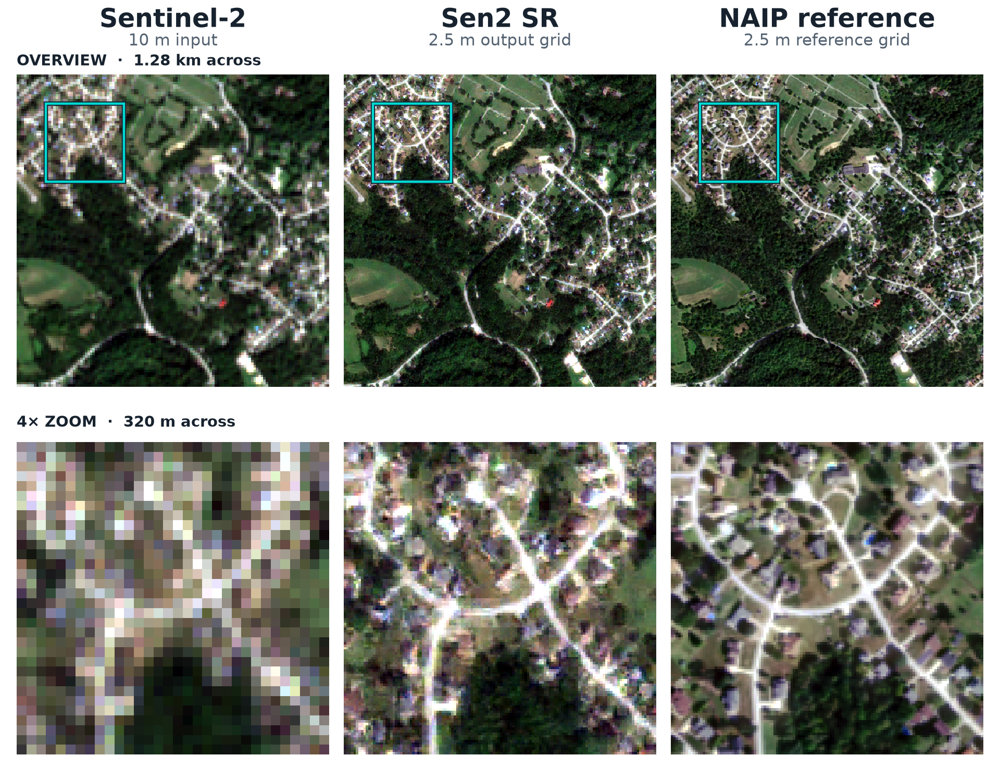
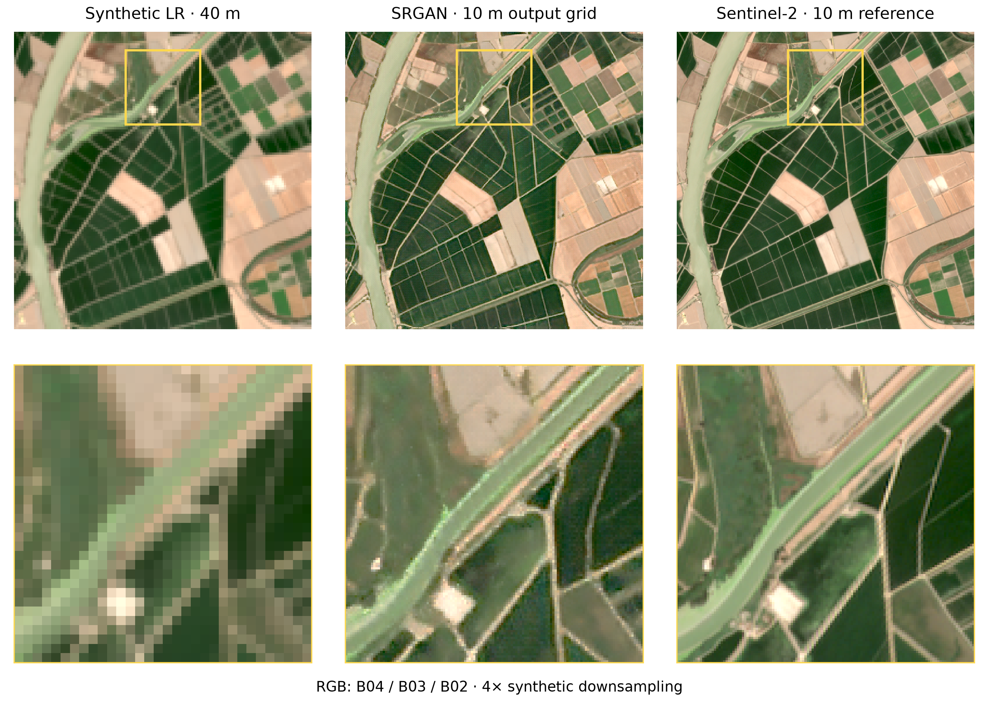

# Results

This page shows some visual results for different configurations and data types.

## Featured: Sen2 SR v1 — real Sentinel-2/NAIP, 4× RGB/NIR

The latest supported checkpoint combines ESRGAN, PatchGAN, multispectral and
local-Gram texture losses, and EMA. It predicts a 2.5 m grid from the four
10 m Sentinel-2 RGB/NIR bands.

*Suburban Pennsylvania: a 1.28 km overview and a 4× zoom into the highlighted
320 m neighborhood. The middle column uses the released EMA checkpoint with
back-projection. Click the figure for full size.*

See the **[Sen2 SR model showcase](sen2-sr.md)** for figure provenance,
recorded RGB/NIR validation metrics, the full recipe, and inference/training checkpoints.

## Earlier examples

### 4× synthetic Sentinel-2 (40 m → 10 m)

This synthetic downsampling example uses a separate model and evaluation setup
from Sen2 SR v1 above.

### RCAB generator + standard discriminator (8× Sentinel-2 20 m → 2.5 m)

**Configuration**
- Generator: RCAB backbone with residual channel attention blocks
- Discriminator: Standard SRGAN discriminator
- Upscaling factor: 8×

**Dataset**
- Sentinel-2 Level-2A tiles using the six 20 m bands (B5, B6, B7, B8A, B11, B12) at 20 m 
- Low-resolution inputs generated via bicubic downsampling to 160 m ground sampling distance

