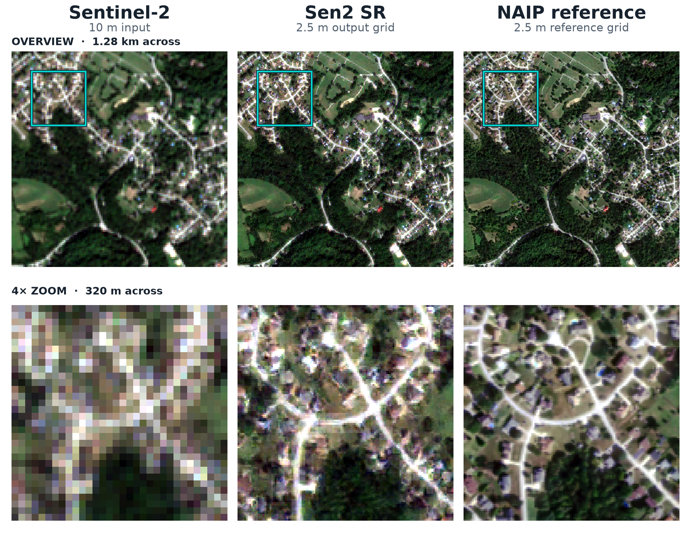

# Sen2 SR v1: model showcase and training recipe

**4× Sentinel-2 super-resolution, with a published recipe and resumable checkpoint.**
`SEN2-SR` takes the four 10 m RGB/NIR bands and predicts imagery on a 2.5 m grid.
It brings together the framework's configurable ESRGAN/PatchGAN pairing,
multispectral losses, local texture learning, EMA, and measurement-consistency
back-projection in one released model.

[Download EMA checkpoint · 68 MB](https://huggingface.co/simon-donike/SR-GAN/resolve/b31d2728952cfaa022bd1df92d82a54c23cf4f8f/models/sen2-sr/v1/weights/inference.ckpt?download=true){ .md-button .md-button--primary }
[Training YAML](https://huggingface.co/simon-donike/SR-GAN/blob/b31d2728952cfaa022bd1df92d82a54c23cf4f8f/models/sen2-sr/v1/training/config.yaml){ .md-button }
[Model card](https://huggingface.co/simon-donike/SR-GAN/blob/b31d2728952cfaa022bd1df92d82a54c23cf4f8f/models/sen2-sr/v1/README.md){ .md-button }

## Results and evaluation scope

[](assets/sen2-sr-v1-rgb.png)

**Top: 1.28 km overview. Bottom: a 4× zoom into the highlighted 320 m
neighborhood.** The three columns show the 10 m Sentinel-2 input, Sen2 SR on a
2.5 m output grid, and the paired NAIP reference. Click the figure for full size.

This suburban scene in Allegheny County, Pennsylvania, comes from the published
validation split (record 680, validation index 1). The SR image is a fresh FP32
CPU prediction from the released EMA checkpoint using `predict_step`, including
the packaged back-projection. RGB bands share the same per-band 1st–99th
percentile display limits across all columns and both rows; nearest-neighbor
display preserves the source pixels. The [figure provenance](assets/sen2-sr-v1-rgb.json)
records the scene ID, checkpoint and split hashes, crop coordinates, and display
settings.

The [recorded validation results](https://huggingface.co/simon-donike/SR-GAN/blob/b31d2728952cfaa022bd1df92d82a54c23cf4f8f/models/sen2-sr/v1/metrics/validation.json)
below describe the latest logged pass over **800 real crosssensor validation
center crops**, using EMA under the original bf16 training evaluation, before
back-projection. The **799 reserved test pairs were untouched**.

| Metric | RGB | NIR |
| --- | ---: | ---: |
| PSNR (dB) | 36.17022 | 30.34680 |
| SSIM | 0.88137484 | 0.75003165 |
| L1 reflectance | 0.01048951 | 0.02211740 |
| VGG distance | 0.99319071 | 1.32213700 |

Four-band L1 is **0.01339648** and SAM is **0.04880648**. These are recorded
validation metrics; a comparative test-set benchmark has not been established.
The release preserves the final state after plateau review, with some strict
multiband fidelity guards unmet. Its texture-oriented predictions contain
generated detail on a 2.5 m grid. Transfer beyond the US Sentinel-2/NAIP
training domain requires evaluation for the intended application.

## Try the checkpoint

```bash
python -m pip install opensr-srgan==1.1.0
```

```python
import torch
from opensr_srgan import load_inference_model

model = load_inference_model("SEN2-SR", map_location="cpu")

# Shape-only smoke test: replace with your own Sentinel-2 patch.
# Raw DN, BCHW, band order B04/B03/B02/B08 (red, green, blue, NIR).
raw_dn = torch.zeros(1, 4, 64, 64)
sr_dn = model.predict_step(raw_dn)
print(sr_dn.shape)  # torch.Size([1, 4, 256, 256])
```

`predict_step` normalizes DN by 10,000, runs the exported EMA generator,
restores DN units, and applies back-projection against the supplied LR values.
It returns a CPU tensor. Use `model.to("cuda")` before prediction for GPU
inference; `map_location` controls checkpoint loading. The direct `model(...)`
interface expects normalized reflectance and returns raw generator predictions.
See [Inference](inference.md) for large-raster tiling and matching options.

## The recipe: framework capabilities in practice

The model starts from the selected +200k-update synthetic-stage checkpoint,
then undergoes real Sentinel-2/NAIP refinement. The preserved final state has
**154,292 real-stage generator updates / 308,584 Lightning optimizer steps**.
The published YAML supports continuation of that trained state.

| Component | Released recipe |
| --- | --- |
| Generator | ESRGAN: 23 RRDBs, 64 feature channels, growth 32, residual scale 0.2, ICNR 4× upsampling. |
| Discriminator | 3-layer PatchGAN, global relativistic-average BCE. |
| Data | Four-band SEN2NAIP crosssensor pairs; aligned 64×64 LR / 256×256 HR crops, rotations and horizontal flips. |
| Spatial split | 6,401 train / 800 validation / 799 reserved test pairs, with exact record IDs published. |
| Training | Batch 12 on one GPU, `bf16-mixed`, gradient clipping 1.0; validation every 250 batches. |
| EMA | Decay 0.99; the inference checkpoint contains the exported EMA generator. |
| Perceptual features | ImageNet-normalized VGG19, preactivation conv5_4; shuffled three-of-four-band triplets during training, fixed RGB plus separate NIR reporting in validation. |
| Prediction matching | Back-projection with 4× block averaging, blur sigma 0, maximum 100 iterations, tolerance `1e-6`. |

| Loss / regularizer | Weight or setting |
| --- | ---: |
| L1 reconstruction | 0.01 |
| Spectral angle (SAM) | 0.005 |
| VGG perceptual | 1.0 |
| Local-Gram texture | 0.46851534843444825, grid 4 |
| Relativistic-average adversarial BCE | 0.00125, cosine ramp, `adv_loss_ramp_steps: 1000` |
| Discriminator R1 | Normalized patch mean, gamma `1.1449030989620114e-6`, every 16 batches |
| Total variation | 0.0 |

The adversarial ramp uses the Lightning optimizer-step counter and has already
completed in the released checkpoint.

The [full training YAML](https://huggingface.co/simon-donike/SR-GAN/blob/b31d2728952cfaa022bd1df92d82a54c23cf4f8f/models/sen2-sr/v1/training/config.yaml)
also records optimizer settings, schedules, and multiband selection thresholds.
Use it as a concrete starting point for experimenting with the framework's
[architectures](architecture.md), [loss configuration](configuration.md), and
[training strategies](training-guideline.md).

## Checkpoints and release artifacts

All links and commands on this page use Hub revision
`b31d2728952cfaa022bd1df92d82a54c23cf4f8f`, matching the packaged preset.
Paths are relative to `models/sen2-sr/v1/` in the
[`simon-donike/SR-GAN` repository](https://huggingface.co/simon-donike/SR-GAN/tree/b31d2728952cfaa022bd1df92d82a54c23cf4f8f/models/sen2-sr/v1).

| Artifact | Use |
| --- | --- |
| [EMA inference checkpoint](https://huggingface.co/simon-donike/SR-GAN/resolve/b31d2728952cfaa022bd1df92d82a54c23cf4f8f/models/sen2-sr/v1/weights/inference.ckpt?download=true) | `weights/inference.ckpt`, approximately 68 MB, generator weights for prediction. |
| [Inference config](https://huggingface.co/simon-donike/SR-GAN/blob/b31d2728952cfaa022bd1df92d82a54c23cf4f8f/models/sen2-sr/v1/config.yaml) | `config.yaml`, paired with the exported EMA weights; runtime EMA tracking is disabled. |
| [Full training checkpoint](https://huggingface.co/simon-donike/SR-GAN/resolve/b31d2728952cfaa022bd1df92d82a54c23cf4f8f/models/sen2-sr/v1/weights/training.ckpt?download=true) | `weights/training.ckpt`, approximately 385 MB, live G/D, optimizers, schedulers, EMA, callbacks and loops. |
| [Training recipe](https://huggingface.co/simon-donike/SR-GAN/blob/b31d2728952cfaa022bd1df92d82a54c23cf4f8f/models/sen2-sr/v1/training/config.yaml) | `training/config.yaml`, portable full-state continuation settings. |
| [Spatial split](https://huggingface.co/simon-donike/SR-GAN/blob/b31d2728952cfaa022bd1df92d82a54c23cf4f8f/models/sen2-sr/v1/training/splits/crosssensor.json) | `training/splits/crosssensor.json`, exact train/validation/test membership. |
| [Provenance](https://huggingface.co/simon-donike/SR-GAN/tree/b31d2728952cfaa022bd1df92d82a54c23cf4f8f/models/sen2-sr/v1/training/provenance) | Executed config, environment, lineage, and source snapshot. |
| [Checksums](https://huggingface.co/simon-donike/SR-GAN/blob/b31d2728952cfaa022bd1df92d82a54c23cf4f8f/models/sen2-sr/v1/SHA256SUMS) | Artifact integrity checks; the [manifest](https://huggingface.co/simon-donike/SR-GAN/blob/b31d2728952cfaa022bd1df92d82a54c23cf4f8f/models/sen2-sr/v1/manifest.json) also records sizes and provenance. |

The model artifacts are MIT licensed; see the release's
[license](https://huggingface.co/simon-donike/SR-GAN/blob/b31d2728952cfaa022bd1df92d82a54c23cf4f8f/models/sen2-sr/v1/LICENSE).

## Continue training

Install the dataset reader, download the published continuation helper, and
point it at your local SEN2NAIP crosssensor TACO index. See [Data preparation](data.md)
for the dataset interface. Choose a new output directory.

```bash
python -m pip install 'opensr-srgan[sen2naip]==1.1.0'
hf download simon-donike/SR-GAN examples/resume_training.py \
  --revision b31d2728952cfaa022bd1df92d82a54c23cf4f8f --local-dir ./sen2-model

python ./sen2-model/examples/resume_training.py \
  --dataset /path/to/crosssensor.taco --output-dir ./sen2-continued \
  --max-steps 328584 --revision b31d2728952cfaa022bd1df92d82a54c23cf4f8f

python -m opensr_srgan.train --config ./sen2-continued/config.yaml
```

The helper downloads the full training checkpoint, matching YAML, and exact
split, writes local paths and release provenance, and prepares a fresh run with
W&B disabled. The last command starts training.

`max_steps` is an **absolute optimizer-step target**: 328,584 permits 10,000
additional generator/discriminator batches from the saved 308,584-step state.
Full-state resume restores the actual G/D learning rates of `1e-6` / `1e-7`;
the YAML's nominal `5e-6` / `5e-7` launch rates do not override saved optimizer
state. Retain the published split for comparable evaluation. The dataloader
cursor and augmentation RNG state were not saved, so a continuation resumes
training state without replaying the identical mid-epoch batch sequence.
